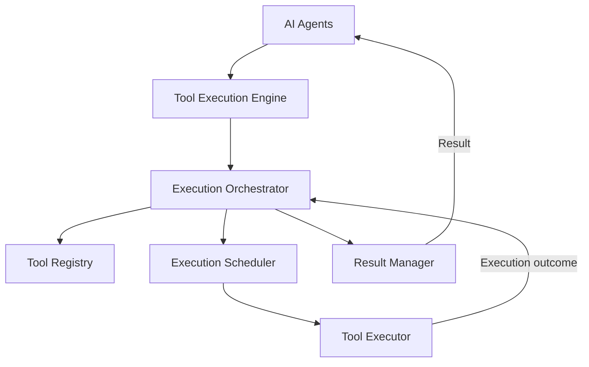

# Tool Execution Engine

A high-performance Java execution runtime designed to handle concurrent tool execution requests from AI agents.

## Why this project exists

AI agents are increasingly capable of reasoning, planning, and interacting with external systems through tools. On paper, these capabilities are impressive. But behind every tool call is an engineering problem: how do we execute these requests efficiently, reliably, and concurrently when hundreds or thousands of agents are competing for shared resources?

An intelligent agent can decide which tool to invoke, but that intelligence alone does not solve scheduling, resource contention, concurrency, backpressure, execution failures, or result delivery.

This project explores the software engineering and fundamental computer science required to turn agent capabilities into reliable execution at scale.

## What we are building

We are building a standalone, framework-independent Java tool execution engine that sits between AI agents and the tools they invoke.

The engine is designed to accept concurrent execution requests, resolve the appropriate tools, schedule work within resource limits, execute tools asynchronously, manage their execution lifecycle, and return results to the requesting agents.

Rather than building another agent framework, the project focuses on the computational infrastructure that makes agent-driven tool execution possible.

**Agents decide what to execute. The engine manages when and how it executes.**

## Core architecture



| Core service | Responsibility |
| --- | --- |
| Tool Registry | Register and resolve available tools. |
| Execution Scheduler | Queue requests, enforce concurrency limits, and manage backpressure. |
| Execution Orchestrator | Coordinate execution and manage lifecycle transitions and failures. |
| Tool Executor | Invoke tools asynchronously and manage execution resources. |
| Result Manager | Track execution state and deliver results to callers. |

The `ToolExecutionEngine` is the public entry point that connects these five logical services within a single JVM.

## Engineering focus

The project explores concurrency and synchronization, scheduling algorithms, bounded queues, resource allocation, asynchronous I/O, execution state machines, failure handling, and performance engineering.

The initial implementation uses Core Java, Maven, and standard concurrency primitives such as `ConcurrentHashMap`, `ArrayBlockingQueue`, `Semaphore`, `ExecutorService`, virtual threads, and `CompletableFuture`.

## Scope and development status

The project is currently a starter scaffold. The core service implementations are under development; high throughput and reliability are design goals, not measured claims.

The first milestone is a working single-JVM, in-memory execution engine capable of handling concurrent independent tool requests. The focus is to implement the five core services, connect them, validate correctness under concurrent workloads, and measure performance before introducing additional complexity.

Distributed execution, external infrastructure, and application frameworks are intentionally outside the initial scope.

## Getting started

Requires Java 21 or later and Maven.

```bash
mvn clean package
```

The starter project provides the core service contracts, implementation skeletons, shared execution models, and engine wiring. The execution behavior must be implemented before the engine can process tool requests end to end.
