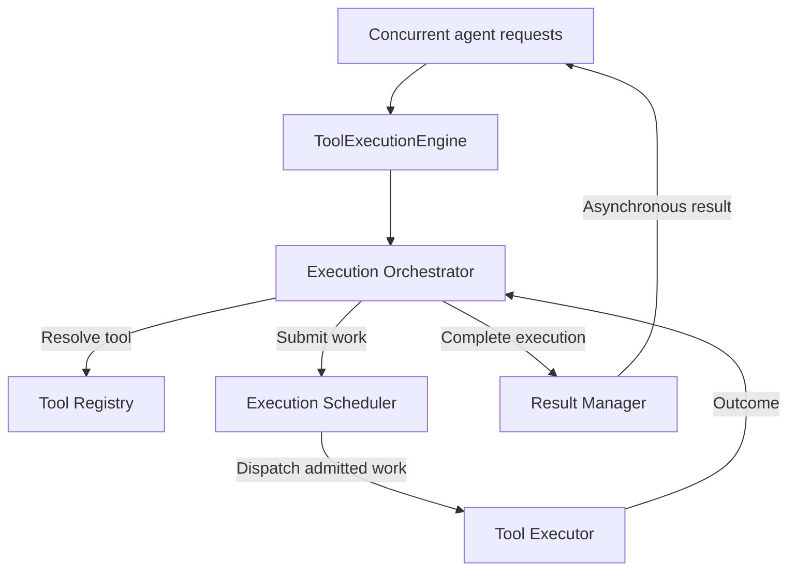
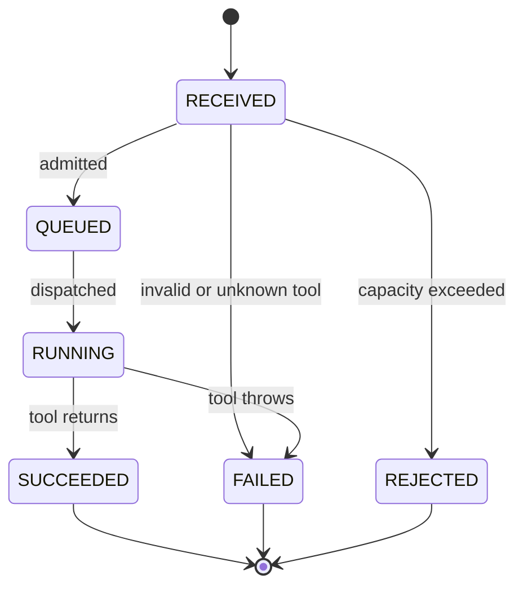

# Tool Execution Engine

A lightweight, framework-independent Java runtime for concurrent tool execution in agentic AI systems. Designed to turn agent-generated tool requests into controlled, asynchronous execution under bounded resources.

## Why this engine exists

AI agents can reason, plan, and decide which tools to invoke. But when many agents begin issuing requests concurrently, the challenge shifts from model intelligence to systems engineering.

Consider a swarm of agents calling APIs, querying databases, or invoking local functions. Each request competes for execution capacity. Uncontrolled concurrency can overwhelm downstream systems, exhaust resources, and increase latency. Requests must be scheduled, failures handled, and results correlated with the agents that initiated them.

A model's ability to select a tool does not solve any of these problems. The Tool Execution Engine provides the runtime layer responsible for managing them, separating agent reasoning from the mechanics of execution.

**Agents decide what to execute. The engine manages when and how it executes.**

## What the engine does

The engine accepts tool execution requests from multiple agents, resolves registered tools, schedules work within bounded capacity, invokes tools asynchronously, tracks execution state, and delivers outcomes to callers through asynchronous handles.

Its core capabilities are:

- Thread-safe tool registration and lookup.
- Bounded request queues, concurrency limits, and overload rejection.
- Asynchronous tool execution using Java virtual threads for blocking I/O workloads.
- Coordinated execution lifecycle and failure handling.
- Request correlation and asynchronous result delivery.

The engine is an embeddable Java library, not an agent framework, model provider, or independently deployed server. It does not decide which tools an agent should call.

## Architecture



The runtime consists of five logical services operating within a single JVM. Each service owns a distinct responsibility and communicates through Java interfaces.

| Component | Responsibility | Implementation approach |
| --- | --- | --- |
| Tool Registry | Register and resolve tool implementations | ConcurrentHashMap |
| Execution Scheduler | Admit, queue, and dispatch requests within capacity limits | ArrayBlockingQueue, Semaphore |
| Execution Orchestrator | Coordinate components and own lifecycle transitions | Explicit state transitions, asynchronous completion |
| Tool Executor | Invoke tools and capture execution outcomes | ExecutorService, virtual threads |
| Result Manager | Correlate execution IDs, track state, and complete result handles | ConcurrentHashMap, CompletableFuture |

`ToolExecutionEngine` is the public entry point and composition root. It wires the five services together and exposes tool registration and request submission.

## Execution lifecycle



A request carries a unique execution ID, agent ID, tool ID, and arguments. The orchestrator resolves the tool and submits work to the scheduler. The scheduler admits requests only within its configured capacity and dispatches work when execution permits are available. The executor invokes the tool and reports its outcome. The orchestrator finalizes the lifecycle, and the result manager completes the corresponding handle.

The caller does not need to block while waiting for execution. Capacity must be released on both success and failure, and terminal results must be completed only once. Completed execution records must have bounded retention so sustained workloads do not cause unbounded memory growth.

## Usage

Requires Java 21 or later and Maven. Build the library with:

```bash
mvn clean verify
```

Example using the engine's public API:

```java
import com.engine.ToolExecutionEngine;
import com.engine.model.ExecutionRequest;
import java.util.Map;
import java.util.UUID;

var engine = new ToolExecutionEngine();
engine.register("echo", arguments -> arguments.get("message"));

var request = new ExecutionRequest(
    UUID.randomUUID(),
    "agent-1",
    "echo",
    Map.of("message", "Hello from an agent")
);

var handle = engine.submit(request);
handle.result().thenAccept(result -> {
    System.out.println(result.status());
    System.out.println(result.output());
});
```

This illustrates asynchronous submission and result handling inside a host application. The host must keep the runtime alive until outstanding work completes and follow the engine's shutdown contract.

## Engineering principles

The engine is built around fundamental computer science and software engineering concepts: concurrency and synchronization, queueing, scheduling, resource allocation, state machines, asynchronous execution, and failure isolation.

Virtual threads make blocking I/O concurrency inexpensive, but do not eliminate resource limits or accelerate CPU-bound computation. Bounded admission and execution capacity remain essential. Component boundaries are kept in-process to avoid unnecessary network and serialization overhead.

## Project structure

```text
src/main/java/com/engine/
├── ToolExecutionEngine.java
├── registry/
├── scheduler/
├── orchestrator/
├── executor/
├── result/
└── model/
```

## Correctness and performance

The engine is designed for high throughput and predictable resource usage. Its evaluation should cover concurrent submissions, queue saturation, tool failures, result correlation, capacity recovery, and sustained workloads. Relevant measurements include throughput, queue waiting time, end-to-end P50/P95/P99 latency, and memory consumption.

Performance depends on the tool workload, hardware, and configured limits. No numerical throughput or latency guarantees are asserted without reproducible benchmark results.

## Scope

The core runtime handles independent tool requests in a single JVM with in-memory state and no required external runtime dependencies. Distributed workers, durable workflows, network APIs, sandboxing, and agent reasoning are outside this scope. Tools run with the host application's permissions; the engine is not a security isolation boundary.
